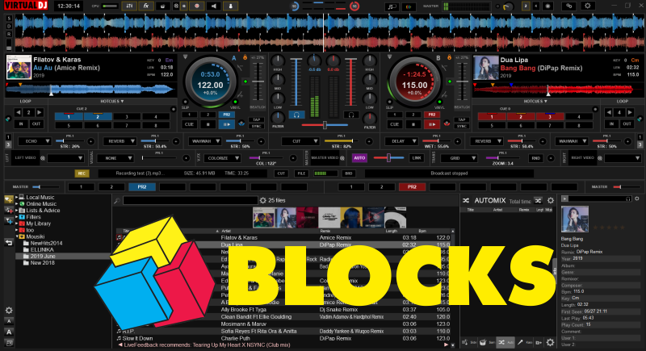

# Blocks – Single Deck Player (VirtualDJ skin)

A single-track player skin for [VirtualDJ](https://www.virtualdj.com/download/index.html), built on the **Blocks** skin by DJDaD. Layout name in VirtualDJ: **Single Deck - Player**.

## Features

- One compact 1920×1080 deck: jog wheel, transport and tempo fader
- Key lock always on, so the tempo fader never changes the key
- Key control in whole semitones plus a continuous fine-key (±1 semitone) fader
- Channel strip: EQ, filter, volume, PFL, gain and VU
- Stems controls
- Loop section with saved-loop display
- Track info panel with a TAG button for the tag editor
- Dark and light (day) modes

## Install

### 1. Install VirtualDJ

1. Download VirtualDJ from <https://www.virtualdj.com/download/index.html>.
2. Run the installer (`.pkg` on macOS, `.exe` on Windows) and follow the prompts.
3. Start VirtualDJ once so it creates its user folder, then close it. (Optional but recommended.)

### 2. Install the skin

1. Download **`BlocksSingle.zip`** from the [latest release](https://github.com/alfonslm/Virtual-DJ-player/releases/latest) and unzip it. You get a folder called `BlocksSingle`.
2. Copy the whole `BlocksSingle` folder into your VirtualDJ **Skins** folder:
   - **macOS:** `~/Library/Application Support/VirtualDJ/Skins`
     (Finder → Go → Go to Folder…, paste the path)
   - **Windows:** `Documents\VirtualDJ\Skins`
     (VirtualDJ → Settings → Options → *Open folder* shortcuts can also take you there)
3. Keep all files in the folder together. The skin needs the images (`icons.png`, `whiteicons.png`, previews) next to the XML files.
4. Start VirtualDJ, open **Settings → Interface → Skin**, pick **Blocks - Single Deck Player**, then choose the **Single Deck - Player** layout if asked. Restart VirtualDJ if the skin does not appear.

More on skins: [VirtualDJ skins page](https://www.virtualdj.com/addons/skins.html) · [Interface settings manual](https://www.virtualdj.com/manuals/virtualdj/settings/interface.html)

## Links

- VirtualDJ download: <https://www.virtualdj.com/download/index.html>
- VirtualDJ skins: <https://www.virtualdj.com/addons/skins.html>
- Original Blocks skin: <https://www.virtualdj.com/forums/220605/addons/Blocks.html>
- DJDaD on VirtualDJ: <https://www.virtualdj.com/user/djdad/>
- This project: <https://github.com/alfonslm/Virtual-DJ-player>

## Credits

- **Blocks skin: DJDaD** (DjDaD Atomix Productions), © 2019. All the original design, graphics and layout code that this skin is built on are theirs.
- **Single Deck Player layout and modifications: alfonslm**, © 2026.
- **VirtualDJ** is a product of Atomix Productions. This project is a fan-made skin and is not affiliated with or endorsed by Atomix or DJDaD.

## Licence

The original Blocks skin remains the property of its author, DJDaD. Check the [Blocks page](https://www.virtualdj.com/forums/220605/addons/Blocks.html) for their terms before redistributing, and contact them if in doubt.
